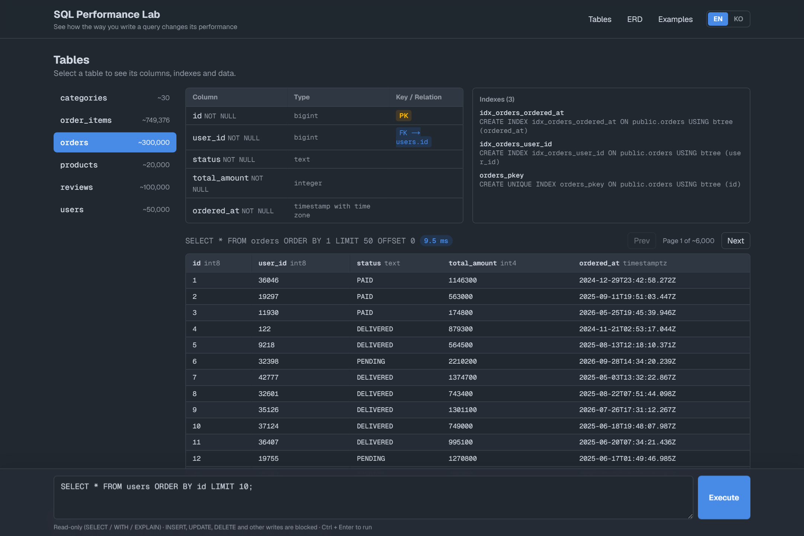
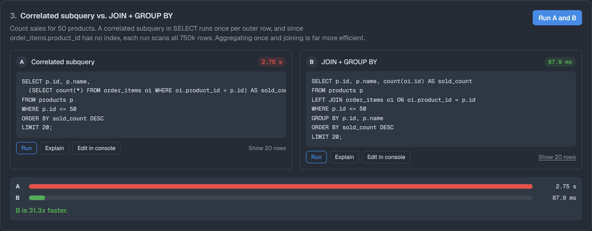
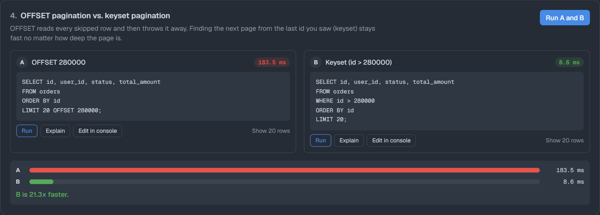
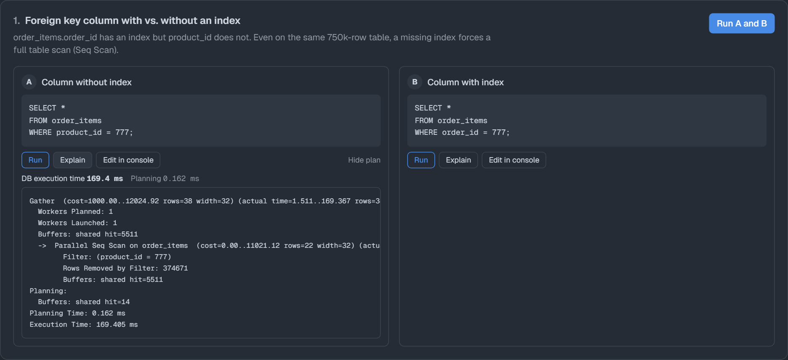
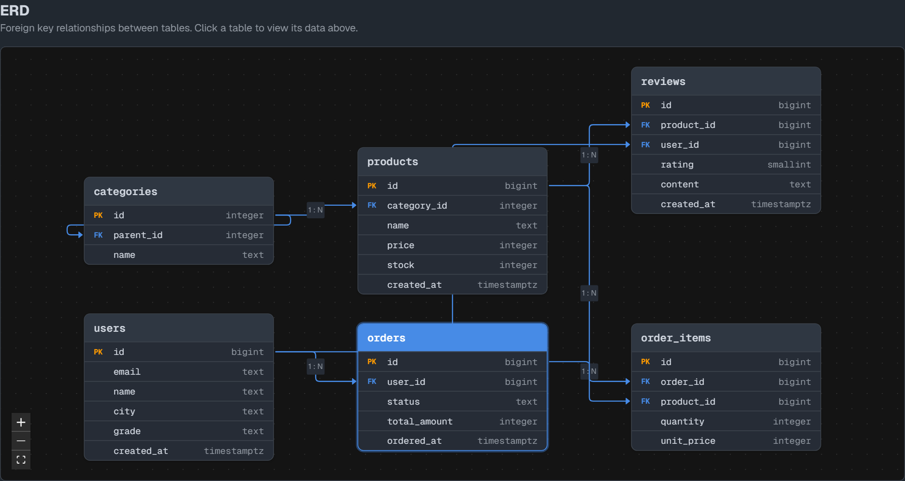
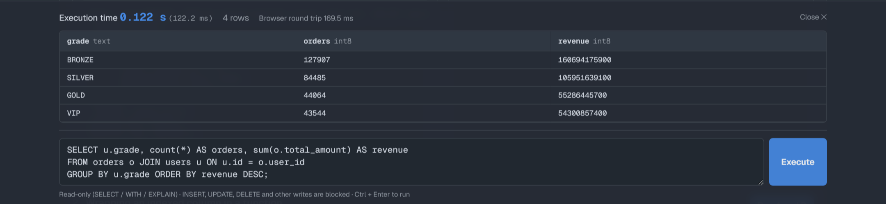
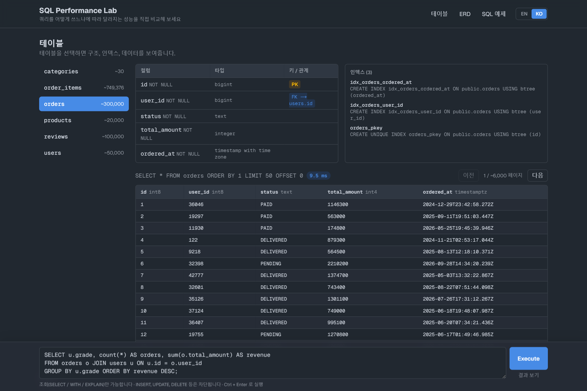
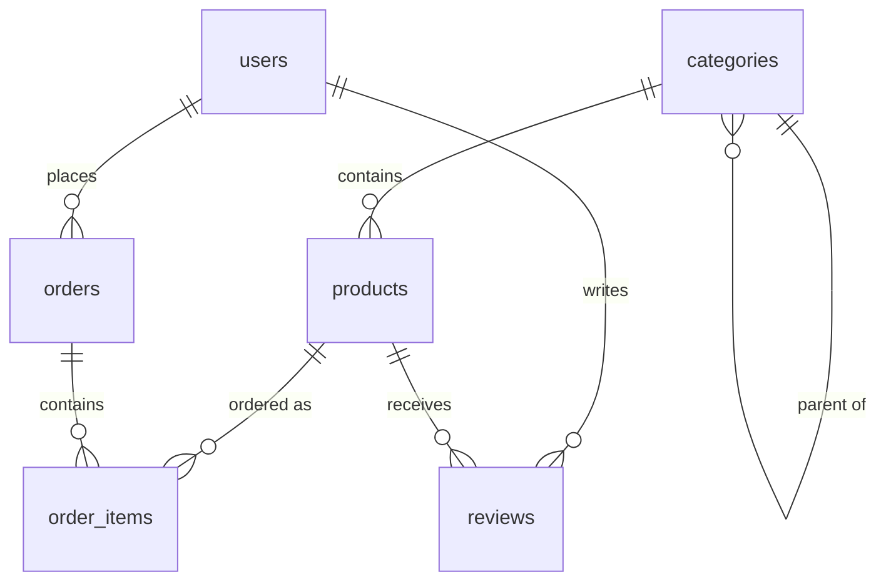

<div align="center">

# SQL Performance Visualizer

**See how the way you write SQL changes its performance.**

Run two queries that answer the same question, side by side on a real Postgres database,<br/>
and compare their timings and execution plans.

### 🚀 [Live demo → visualizer-sql-performance.vercel.app](https://visualizer-sql-performance.vercel.app)

[](https://visualizer-sql-performance.vercel.app)


<br/>



</div>

---

## Features

| | |
| --- | --- |
| 🗂️ **Table browser** | Pick a table to see its columns, primary and foreign keys, indexes and paginated rows, along with how long each page took to load. |
| 🧭 **Interactive ERD** | Foreign key relationships drawn as a draggable, zoomable diagram. Click a table to jump to its data. |
| ⚡ **A/B query comparison** | 8 built-in scenarios. Run both versions and see the timings as bars, plus how many times faster the winner is. |
| 🔍 **EXPLAIN ANALYZE** | Open the execution plan for any example to see the time spent inside the database. |
| 💻 **SQL console** | Pinned to the bottom of the page. Type any `SELECT`, press `Ctrl + Enter`, and get the execution time and the result. |
| 🔒 **Read-only by design** | `INSERT`, `UPDATE`, `DELETE`, DDL and multi-statement queries are blocked at three layers. |
| 🌐 **English / 한국어** | Switch languages from the header. Your choice is remembered. |

## Screenshots

### A/B comparison

Run both queries and see which is faster, and by how much.




### EXPLAIN ANALYZE

See the plan behind the timing. Here, a missing index turns into a parallel sequential scan.



### ERD



### SQL console



<details>
<summary><b>한국어 UI</b></summary>
<br/>

</details>

## Built-in scenarios

| # | Slower (A) | Faster (B) | What it shows |
| --- | --- | --- | --- |
| 1 | Filter on an unindexed FK | Filter on an indexed FK | Seq Scan vs. Index Scan |
| 2 | `ordered_at::date = …` | `ordered_at >= … AND < …` | A function on a column disables its index |
| 3 | Correlated subquery | `JOIN` + `GROUP BY` | A subquery that runs once per row |
| 4 | `LIMIT 20 OFFSET 280000` | `WHERE id > 280000 LIMIT 20` | Keyset pagination stays fast on deep pages |
| 5 | `SELECT *` | Only the needed columns | Less data read and sent |
| 6 | `COUNT(*) > 0` | `EXISTS (…)` | Stop at the first match |
| 7 | `NOT IN (subquery)` | `NOT EXISTS (…)` | Anti join vs. row-by-row comparison |
| 8 | `LIKE '%…'` | `= '…'` | A leading wildcard can't use a B-tree index |

Measured on a local Postgres 17 with the sample data:

```
Correlated subquery   895.0 ms  ███████████████████████████████
JOIN + GROUP BY        28.5 ms  █

OFFSET 280000         101.1 ms  ███████████████████████████████
Keyset pagination       0.8 ms  ▏
```

## Getting started

### 1. Install

```bash
git clone https://github.com/Mithpasong/visualizer-sql-performance.git
cd visualizer-sql-performance
npm install
```

### 2. Connect a database

Create a free project on [Supabase](https://supabase.com), then go to **Connect → Direct → Session pooler** and copy the connection string.

```bash
cp .env.example .env.local
```

```env
DATABASE_URL=postgresql://postgres.<project-ref>:<password>@aws-0-<region>.pooler.supabase.com:5432/postgres
```

> Any PostgreSQL database works, not just Supabase. Connections to `localhost` skip SSL.

### 3. Load the sample data

```bash
npm run db:setup
```

This creates 6 tables and loads about **1.2M rows** with `generate_series`. It takes about 15 seconds on a local database.

> ⚠️ `db:setup` drops and recreates `users`, `categories`, `products`, `orders`, `order_items` and `reviews`.

### 4. Run

```bash
npm run dev
```

Open **http://localhost:4080**.

## Sample schema



| Table | Rows | Intentionally **not** indexed |
| --- | ---: | --- |
| `users` | 50,000 | `name`, `city` |
| `categories` | 30 | |
| `products` | 20,000 | |
| `orders` | 300,000 | `status` |
| `order_items` | ~750,000 | `product_id` |
| `reviews` | 100,000 | `user_id` |

Some columns are left without an index on purpose so the scenarios have something to compare.

## How writes are blocked

1. **SQL guard** ([`src/lib/sql-guard.ts`](src/lib/sql-guard.ts)): rejects anything that doesn't start with `SELECT` / `WITH` / `EXPLAIN`, multiple statements, and write keywords. Comments and string literals are ignored while checking.
2. **Read-only transaction** ([`src/lib/db.ts`](src/lib/db.ts)): every query runs inside `BEGIN READ ONLY` with a 15-second `statement_timeout`, uses the extended protocol (one statement per query), and is always rolled back.
3. **Read-only role** (recommended): [`db/readonly-role.sql`](db/readonly-role.sql) creates a `SELECT`-only account for the app. Use it as `DATABASE_URL`, and set `ADMIN_DATABASE_URL` for `db:setup`.

## About the timings

- **Execution time** is measured on the Next.js server and covers running the query and receiving every row, including the network round trip to the database. Only the first 500 rows are sent to the browser.
- **DB execution time** under **Explain** is Postgres's own `Execution Time` from `EXPLAIN ANALYZE`.
- The first run of a query is often slower because caches are cold. Run each query a few times before comparing.

## Project structure

```
db/
  schema.sql            Tables and indexes
  seed.sql              Sample data generator
  readonly-role.sql     Optional read-only account
scripts/
  db-setup.mjs          npm run db:setup
src/
  app/api/
    schema/             Tables, columns, keys and indexes
    tables/[name]/      Paginated table rows
    query/              Run or EXPLAIN a read-only query
  components/           Table browser, ERD, examples, SQL console
  lib/
    examples.ts         A/B scenarios (add your own here)
    i18n.ts             English / Korean messages
    sql-guard.ts        Read-only SQL check
    db.ts               Connection pool and timed query runner
```

## Adding a scenario

Add an entry to [`src/lib/examples.ts`](src/lib/examples.ts):

```ts
{
  id: "my-scenario",
  title: { en: "My comparison", ko: "나의 비교" },
  description: { en: "Why B is faster.", ko: "B가 더 빠른 이유." },
  variants: [
    { label: { en: "Slow", ko: "느림" }, sql: `SELECT ...` },
    { label: { en: "Fast", ko: "빠름" }, sql: `SELECT ...` },
  ],
},
```

## Tech stack

[Next.js 16](https://nextjs.org) (App Router) · [React 19](https://react.dev) · [Tailwind CSS 4](https://tailwindcss.com) · [node-postgres](https://node-postgres.com) · [React Flow](https://reactflow.dev) · [dagre](https://github.com/dagrejs/dagre) · [Supabase](https://supabase.com)

## License

[MIT](LICENSE) © Mithpasong
